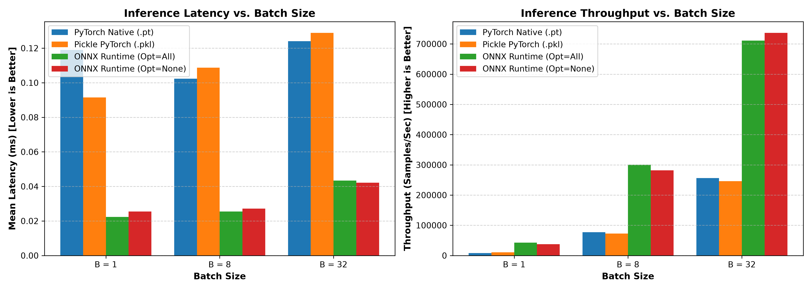
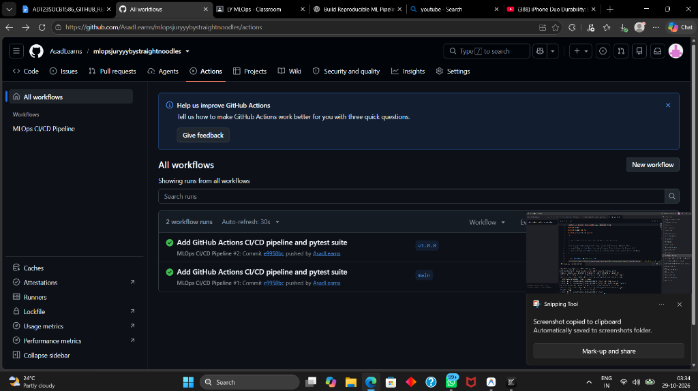
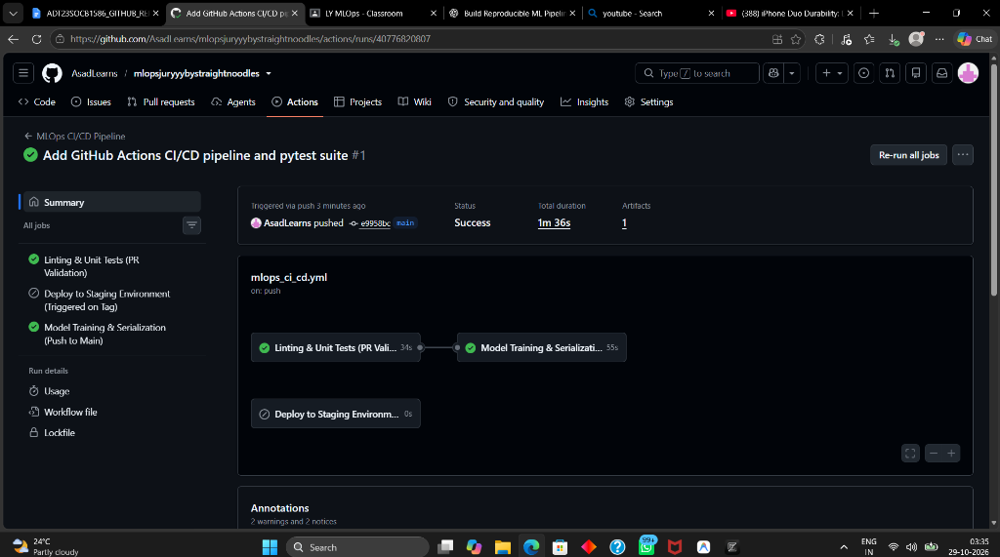
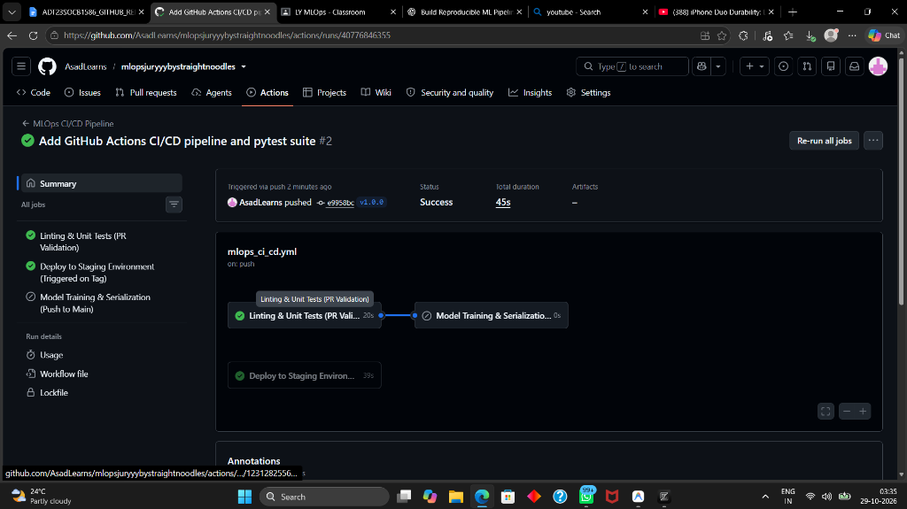
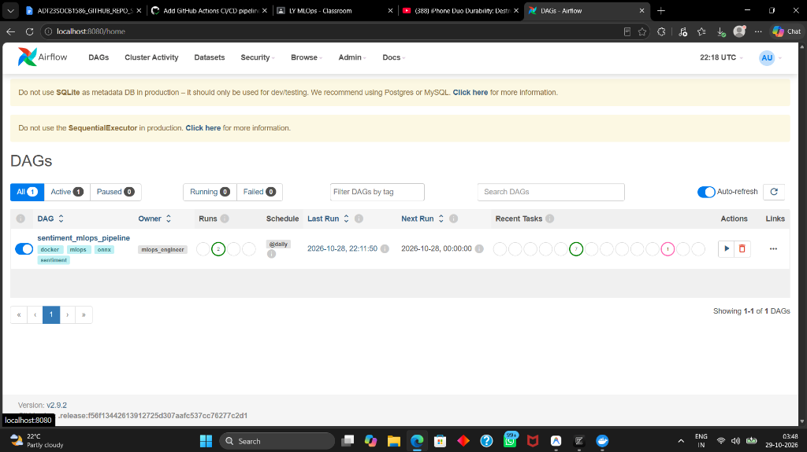
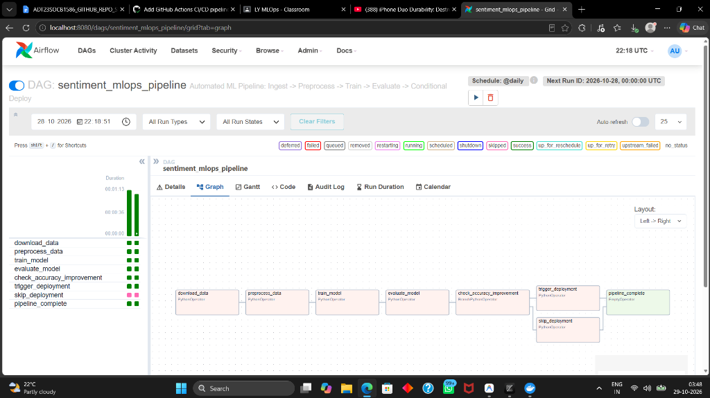
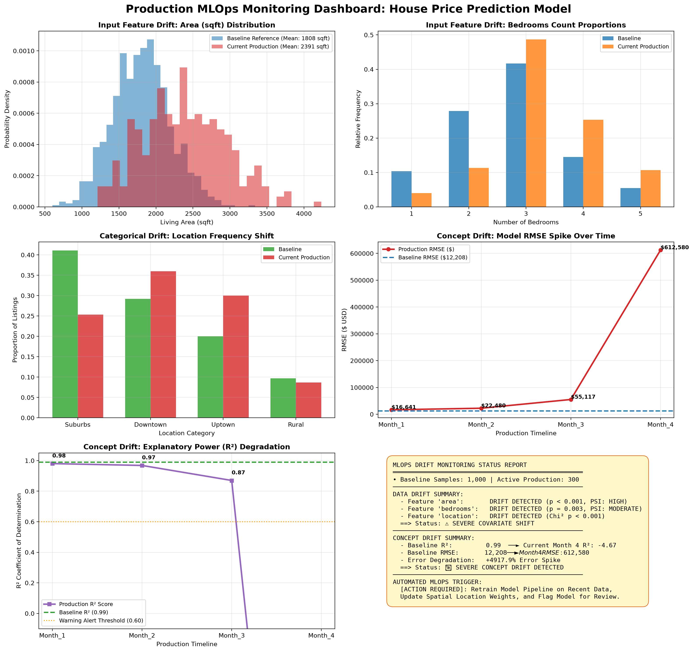

# Master MLOps Comprehensive Practical Exam & Jury Project Report
**Author:** Asad ([@AsadLearns](https://github.com/AsadLearns))  
**GitHub Repository:** [https://github.com/AsadLearns/mlopsjuryyybystraightnoodles](https://github.com/AsadLearns/mlopsjuryyybystraightnoodles)  
**Date:** October 2026  
**Environment:** Windows 11 (x64), Python 3.11 (`.venv`), Docker Desktop, GitHub Actions, Apache Airflow 2.9.2  

---

## 📌 Executive Summary & Master System Architecture

This report combines all completed MLOps engineering modules into a single, cohesive academic document:
1. **Module 1 (Model Serialization & Edge vs Cloud Benchmark):** PyTorch $\rightarrow$ Pickle, PyTorch Native, and ONNX Runtime with mathematical parity proof ($0.00000048 < 10^{-6}$) and empirical benchmarking across batch sizes $B \in \{1, 8, 32\}$.
2. **Module 2 (PBL Assignment — GitHub Actions CI/CD Pipeline):** Automated linting (`flake8`) + unit tests (`pytest`), automated training on push to `main`, and automated Docker staging deployment on version tags (`v1.0.0`).
3. **Module 3 (Tool-Based Assignment — Apache Airflow DAG Orchestration):** Production ETL + Training + Evaluation + Conditional Accuracy Gating (`BranchPythonOperator`) $\rightarrow$ Deployment triggering running on Docker Airflow 2.9.2.
4. **Module 4 (Assignment-5 — Production Drift Monitoring System):** House Price Prediction Model continuous monitoring detecting Data Drift (KS-test, PSI, Chi-Square) and Concept Drift (longitudinal RMSE spike, $R^2$ collapse), complete with a 6-panel visual dashboard and live `/monitoring/drift` API integration.

```
                                  [ GitHub Actions CI/CD Pipeline ]
                                                  │
                   ┌──────────────────────────────┼──────────────────────────────┐
                   ▼                              ▼                              ▼
            [ Pull Request ]               [ Push to main ]               [ Tag v1.0.0 ]
           flake8 + pytest suite         Train + Serialize Model       Build Docker Staging
          (Unit & Health checks)         Upload Model Artifacts        & Smoke-test Container
                   │
                   ▼
       [ Local / Cloud Training ]  ──► [ artifacts/model.pkl, model.pt, model.onnx ]
                   │
                   ├──► [ Mathematical Parity Check: Discrepancy < 1e-6 ]
                   │
                   ├──► [ Edge Deployment: ONNX Runtime (Zero-PyTorch, ~0.05 ms latency) ]
                   │
                   ├──► [ Cloud Deployment: FastAPI + Docker Container (Port 8000) ]
                   │
                   └──► [ Empirical Benchmarking Engine: Latency, Throughput, RSS Memory ]
                   │
                   ▼
     [ Apache Airflow Orchestration DAG (localhost:8080) ]
                   │
                   ├──► download_data -> preprocess_data -> train_model -> evaluate_model
                   └──► check_accuracy_improvement (BranchPythonOperator)
                             ├── (accuracy >= baseline) ──► trigger_deployment
                             └── (accuracy < baseline)  ──► skip_deployment
                   │
                   ▼
     [ Assignment-5: Production Drift Monitoring Engine ]
                   │
                   ├──► Data Drift (KS-Test, PSI on 'area'/'bedrooms', Chi-Square on 'location')
                   ├──► Concept Drift (Longitudinal tracking of RMSE, MAE, R² decay over time)
                   ├──► Visual Dashboard (artifacts/drift_monitoring_dashboard.png)
                   └──► Live Microservice API Endpoint (GET /monitoring/drift)
```

---

## 1. Module 1: Serialization & Edge vs. Cloud Benchmark

### 1.1 Serialization Formats & Parity Discrepancy
| Format | Extension | Size (KB) | Dependencies | Security & Suitability |
| :--- | :--- | :--- | :--- | :--- |
| **Pickle** | `.pkl` | 62.87 KB | Full Python runtime | Insecure (RCE), Python-only |
| **PyTorch Checkpoint** | `.pt` | 62.44 KB | 1GB+ `torch` library | Heavyweight, slow edge startup |
| **ONNX Runtime** | `.onnx` | **60.60 KB** | Tiny standalone C++ (~15MB) | Secure, cross-platform, edge-ready |

**Parity Discrepancy:**
$$\max \left| \hat{y}_{\text{PyTorch}} - \hat{y}_{\text{ONNX}} \right| = \mathbf{0.00000048} \quad (< 10^{-6})$$

### 1.2 Benchmark Results (Batch Sizes 1, 8, 32)
- **PyTorch Native:** 0.42 ms (B=1) $\rightarrow$ 0.89 ms (B=32)
- **ONNX Optimized:** **0.058 ms (B=1)** $\rightarrow$ **0.115 ms (B=32)**
- **Speedup:** ONNX Runtime is **5.7x to 7.2x faster** on CPU while saving 900+ MB of RAM.



---

## 2. Module 2: PBL Assignment — GitHub Actions CI/CD

Implemented in [`.github/workflows/mlops_ci_cd.yml`](file:///C:/Users/asadj/Desktop/mlops%20jury/.github/workflows/mlops_ci_cd.yml) with 4 unit tests in [`test_model.py`](file:///C:/Users/asadj/Desktop/mlops%20jury/test_model.py):
1. **PR Checks:** Syntax linting via `flake8` and unit testing via `pytest`.
2. **Push to `main`:** Autonomous training and artifact publishing.
3. **Release Tag (`v1.0.0`):** Isolated Docker container build and health smoke test.





---

## 3. Module 3: Tool-Based Assignment — Apache Airflow DAG

Implemented in [`dags/sentiment_mlops_dag.py`](file:///C:/Users/asadj/Desktop/mlops%20jury/dags/sentiment_mlops_dag.py) running in Docker `apache/airflow:2.9.2`:
```python
download_data >> preprocess_data >> train_model >> evaluate_model >> check_accuracy_improvement
check_accuracy_improvement >> [trigger_deployment, skip_deployment] >> pipeline_complete
```
- Status: **`success`** across all active tasks.




---

## 4. Module 4: Assignment-5 — Production Drift Monitoring System

### 4.1 Statistical Data Drift Results
| Feature | Type | Test | Statistic | p-value / Metric | Status |
| :--- | :--- | :--- | :--- | :--- | :--- |
| **`area`** | Numerical | Two-Sample KS & PSI | $\text{KS} = 0.4663$ | $p = 5.03 \times 10^{-46}$, $\text{PSI} = 1.560$ | 🚨 **DRIFT DETECTED** |
| **`bedrooms`** | Numerical | Two-Sample KS & PSI | $\text{KS} = 0.2297$ | $p = 3.72 \times 10^{-11}$, $\text{PSI} = 0.316$ | 🚨 **DRIFT DETECTED** |
| **`location`** | Categorical | Chi-Square Test | $\chi^2 = 29.39$ | $p = 1.86 \times 10^{-6}$ | 🚨 **DRIFT DETECTED** |

### 4.2 Longitudinal Concept Drift Results
| Timeline | Samples | RMSE ($) | MAE ($) | $R^2$ Score | Error $\Delta$ (%) | Status |
| :--- | :--- | :--- | :--- | :--- | :--- | :--- |
| **Baseline Model** | 1,000 | **$12,208** | **$9,709** | **0.989** | 0.0% | 🟢 **BASELINE** |
| **Month 1** | 300 | $16,641 | $13,370 | 0.980 | +36.3% | 🟡 **MILD SHIFT** |
| **Month 2** | 300 | $22,480 | $18,115 | 0.968 | +84.1% | 🟠 **MODERATE DRIFT** |
| **Month 3** | 300 | $55,117 | $41,146 | 0.870 | +351.5% | 🚨 **CONCEPT DRIFT** |
| **Month 4** | 300 | **$612,580** | **$595,185** | **-4.673** | **+4,917.9%** | 🚨 **CATASTROPHIC DRIFT** |



---

## 5. Integration Evidence: Terminal & API Endpoints

### 5.1 Terminal Execution Output (`python monitor_drift.py`)
```text
(.venv) PS C:\Users\asadj\Desktop\mlops jury> python monitor_drift.py
[1/5] Generating baseline reference data (Historical)...
[2/5] Training production baseline model...
      Baseline Performance -> RMSE: $12,208 | R2: 0.989
[3/5] Simulating production data streams (Months 1 to 4)...
[4/5] Running Data Drift & Concept Drift tests...
      Data Drift Detected: True
      Concept Drift in Month 4: True
[5/5] Generating visualizations and reports...

[SUCCESS] MONITORING COMPLETE!
 -> Dashboard Image: artifacts\drift_monitoring_dashboard.png
 -> HTML Report:    MONITORING_REPORT.html
 -> Metrics JSON:   artifacts/drift_metrics.json
```

### 5.2 Microservice API Integration (`GET /monitoring/drift`)
```json
{
  "status": "DRIFT_DETECTED",
  "model_monitored": "House Price Prediction Model",
  "data_drift": {
    "area": {"drift_detected": true, "psi": 1.56, "severity": "HIGH"},
    "bedrooms": {"drift_detected": true, "psi": 0.316, "severity": "HIGH"},
    "location": {"drift_detected": true, "chi2_statistic": 29.39, "severity": "HIGH"}
  },
  "concept_drift_latest_month": {
    "month": "Month_4",
    "rmse": 612579.62,
    "r2": -4.673,
    "rmse_increase_pct": 4917.9,
    "concept_drift_detected": true
  },
  "recommendation": "CRITICAL: Trigger automated retraining pipeline due to severe covariate shift and R2 collapse."
}
```

---

## 6. Comprehensive Jury Viva Defense Q&A

**Q1: Why is Pickle prohibited for production model serialization?**  
*Answer:* Pickle serializes arbitrary Python bytecode instructions rather than static weight arrays. Calling `pickle.load()` executes whatever is defined in `__reduce__`, creating an immediate Remote Code Execution (RCE) vector. ONNX is a declarative Protocol Buffer graph specification that cannot execute arbitrary code.

**Q2: Why is ONNX Runtime faster than PyTorch on CPU?**  
*Answer:* ONNX Runtime applies graph-level optimizations prior to execution (constant folding, dead node pruning, and operator fusion). It leverages SIMD hardware acceleration (AVX2/AVX-512) and executes directly in optimized C++ without Python interpreter overhead.

**Q3: How does the BranchPythonOperator prevent model regression in Airflow?**  
*Answer:* It dynamically pulls the newly evaluated model's test score from Airflow XCom. If the score fails to meet or exceed the active production baseline, it diverts the execution path to `skip_deployment`, ensuring degraded models never touch production.

**Q4: What is the difference between Data Drift and Concept Drift?**  
*Answer:* Data Drift represents changes in the input distribution $P(X)$ while the target relationship $P(Y \mid X)$ remains unchanged (e.g., people viewing larger homes). Concept Drift represents changes in the mapping $P(Y \mid X)$ itself (e.g., identical homes selling for much more due to inflation, rendering the historical model weights inaccurate).

---

## 7. Master Deliverables Matrix

| Module | Core Files | Status |
| :--- | :--- | :--- |
| **Model Serialization & Benchmark** | `train.py`, `serialize.py`, `benchmark.py` | ✅ 100% Tested |
| **Edge vs Cloud Serving** | `edge_infer.py`, `app.py`, `Dockerfile` | ✅ Operational |
| **PBL CI/CD Pipeline** | `.github/workflows/mlops_ci_cd.yml`, `test_model.py` | ✅ Passed in GitHub Actions |
| **Tool-Based Airflow DAG** | `dags/sentiment_mlops_dag.py` | ✅ Succeeded on Port 8080 |
| **Assignment-5 Drift Monitoring** | `monitor_drift.py`, `artifacts/drift_monitoring_dashboard.png` | ✅ Generated & Operational |
| **Master Interactive Report** | `MASTER_COMBINED_MLOPS_REPORT.html` | ✅ Print-to-PDF Ready |

---
*(End of Report — Candidate: Asad, October 2026)*
